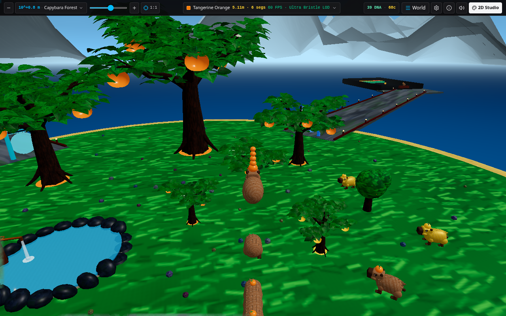
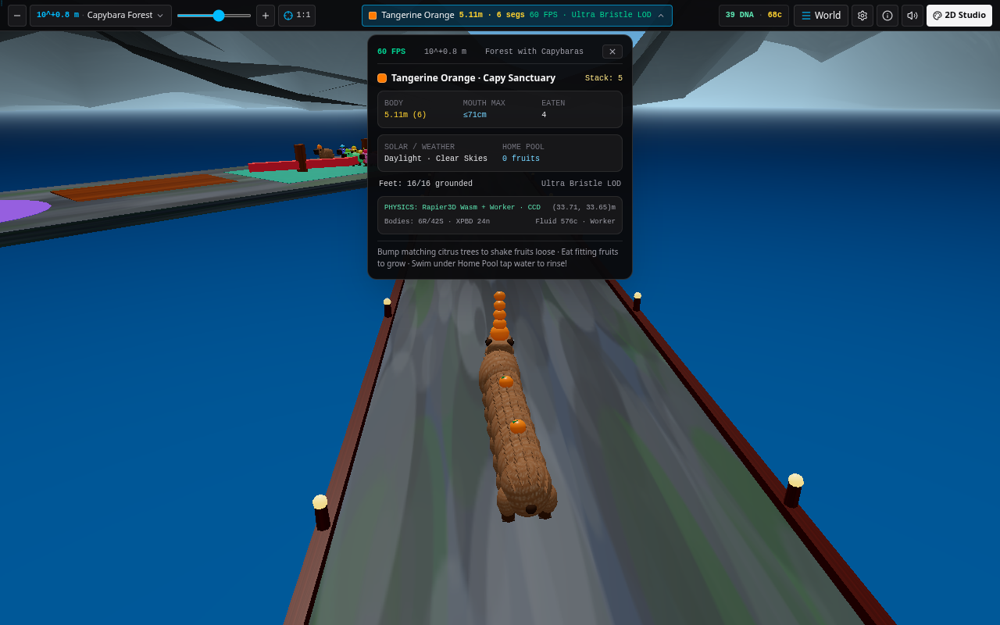
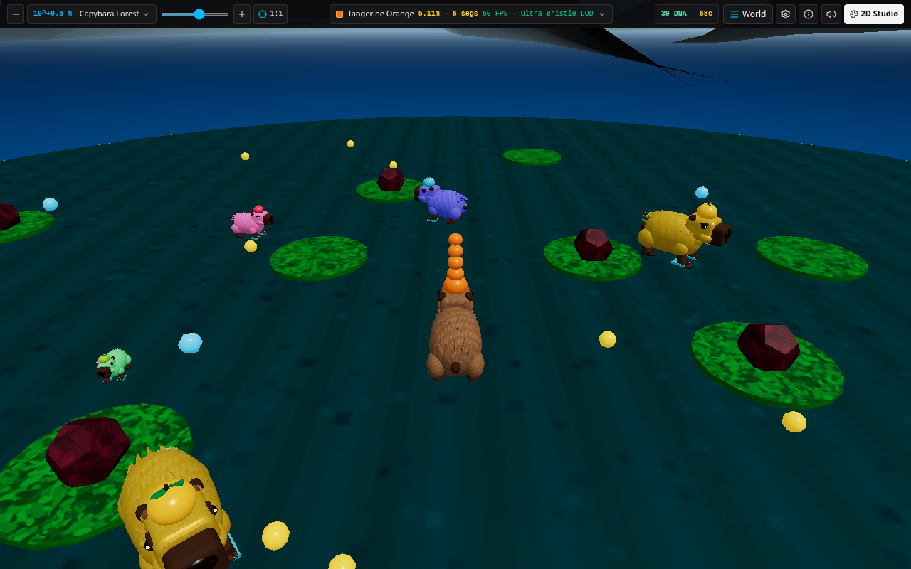
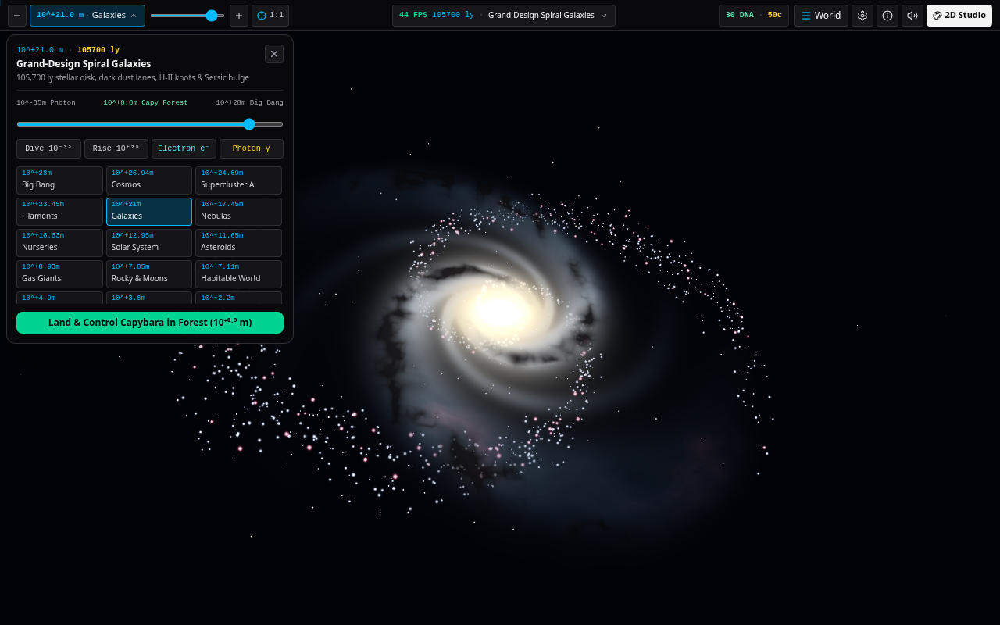
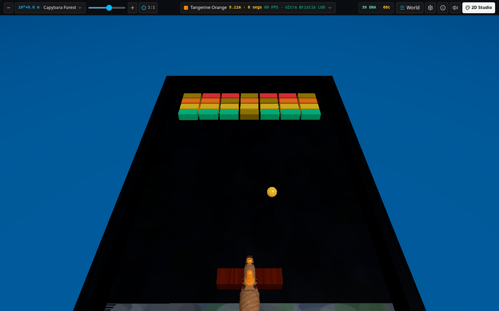
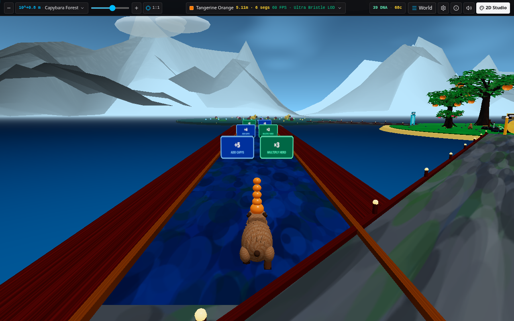
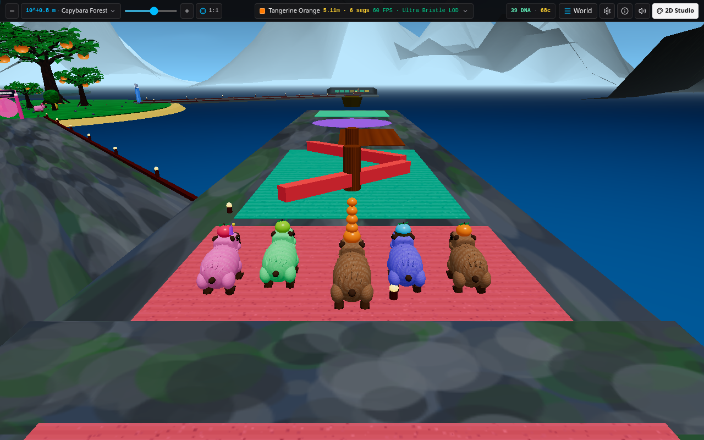
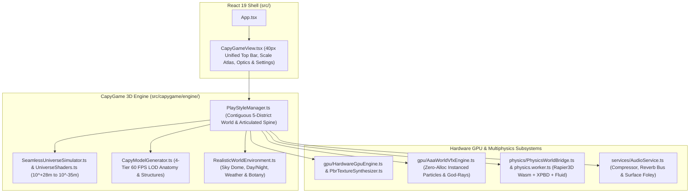

# CapyGame 3D: Multi-Scale Universe Simulator & Contiguous Capybara World

[](https://shthed.github.io/capygame/)
[](./LICENSE.md)

**CapyGame 3D** is a hardware-accelerated 3D multi-scale universe simulator, sandbox island builder, and multiphysics mini-game archipelago built with React 19, TypeScript, Three.js, Vite 6, Tailwind CSS 4, and `@dimforge/rapier3d-compat` WebAssembly physics.

- **63-Orders-of-Magnitude `1:1` Universe Simulator**: Zoom continuously from `10^+28 m` (Big Bang Cosmic Horizon) down through superclusters, spiral galaxies, emission nebulae, Keplerian solar systems, planetary atmospheres, and the `10^+0.8 m` Capybara Forest clearing all the way to `10^-35 m` (Planck Quantum Foam), complete with unlockable **Object Finder Markers** and a **Logarithmic/Exponential Reality Rescaler**.
- **Contiguous Single-World Archipelago**: Walk seamlessly overland between **Capy Sanctuary**, **Spore Lagoon**, **Yuzu Breakout**, **Number Stampede**, and **Yuzu Mountain Parkour** across four `9.6 m`-wide **Grand Promenade Causeways** without loading screens.
- **Hardware-Accelerated 3D GPU & Multiphysics Engine**: Features Sobel tangent-space PBR textures across all 5 districts, PMREM IBL, texel-snapped directional solar shadow cascades, `EffectComposer` HDR bloom + linearized Depth-SSAO + optical Depth-of-Field + CAS sharpening, zero-allocation GPU `InstancedMesh` VFX, studio Web Audio reverb/foley, and off-thread Rapier3D Wasm + XPBD soft-body + shallow-water buoyancy simulation.

---

## Visual Showcase

<p align="center">
  
  <br>
  <em>Capy Sanctuary Hub: Central 3D island with procedural exponential fruit trees, sunken Home Pool, Dachshund Capy-Snake trail, single 40px top control bar, and behind-the-capybara chase camera.</em>
</p>

<p align="center">
  
  <br>
  <em>Contiguous Single-World Archipelago: Seamless overland traversal across the paved Grand Promenade Causeways with live multi-threaded Rapier3D Wasm physics telemetry.</em>
</p>

| **Spore Lagoon Evolution (`spore`)** | **Spore DNA Mutation Lab (`dna`)** |
| :---: | :---: |
|  |  |
| *Swim in the NW Lagoon, harvest plankton, and grow mass to earn Spore DNA* | *Equip visible 3D anatomical mutations including Flippers, Glide Wings, and Bioluminescent Tail* |

| **Yuzu Breakout (`breakout`)** | **Number Stampede (`runner`)** |
| :---: | :---: |
|  |  |
| *Endless 3D crystal bumper stadium in the NE Bay with swept-CCD ricochet physics* | *Steer your visible 3D capybara herd down the SW Causeway through arithmetic gates* |

<p align="center">
  
  <br>
  <em>Yuzu Mountain Parkour (`fallguys`): Navigate rigid-body sweeper hammers, torque-balanced see-saws, and XPBD soft-body launch pads in the SE Peak gauntlet.</em>
</p>

---

## Architecture Overview



---

## Five Contiguous World Districts

| District Key | World Coordinates | Core Mechanics | Progression & Unlocks |
| :--- | :--- | :--- | :--- |
| `sanctuary` | **Capy Sanctuary (`0, 0`)** | Place and upgrade Onsen Hot Springs, Yuzu Orchards, Sacred Pagodas, and Bouncy Pads; bump matching trees to grow your Dachshund Capy-Snake trail. | Sandbox island customization, CapyCoins, and Spore DNA milestones. |
| `spore` | **Spore Lagoon (`-75, -75`)** | Walk down the NW Promenade beach into bioluminescent waters, harvest plankton, and splice 3D body mutations. | Spore DNA points and Lagoon mass high scores. |
| `breakout` | **Yuzu Breakout (`+75, -75`)** | Enter the NE Stadium forecourt to deflect Golden Yuzu spheres into crystal fortresses across endless waves. | Wave clear DNA bonuses, combo multipliers, and Breakout high scores. |
| `runner` | **Number Stampede (`-75, +75`)** | Guide your 3D Capybara herd down the SW Causeway through additive and multiplicative math gates with side return boardwalks. | Herd size records, DNA bonuses, and Stampede high scores. |
| `fallguys` | **Yuzu Mountain (`+75, +75`)** | Climb the SE Gauntlet past rotating hammers, dynamic see-saws, and XPBD launch pads to claim the Golden Crown. | Crown completion DNA bonuses and Yuzu Mountain high scores. |

---

## Documentation Index

- **Technical Architecture & Engine Reference**: [`WEB.md`](./WEB.md)
- **Automated Testing & Verification Guide**: [`TESTING.md`](./TESTING.md)
- **Active Roadmap**: [`TODO.md`](./TODO.md)
- **Contributor & Operational Playbook**: [`AGENTS.md`](./AGENTS.md)

---

## Developer Quick Start

```bash
npm install
npm run dev
```

Open `http://localhost:3000` in your browser.

### Build & Automated Verification

```bash
npm run lint                 # Strict TypeScript type-checking (tsc -p tsconfig.json --noEmit)
npm run build                # Production bundle compilation into dist/
npm run test:game            # End-to-end Playwright suite (scripts/test-capygame.mjs)
npm run test:pwa             # Offline Service Worker & PWA manifest verification
npm run gallery:capture      # Capture 3D district showcase screenshots
npm run gallery:capture:zoom # Capture all 25 logarithmic universe scale screenshots
```
