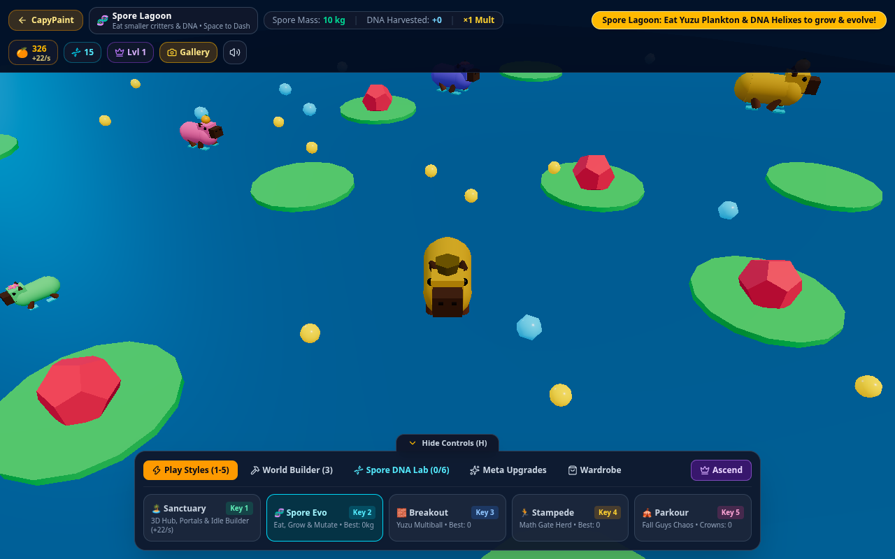
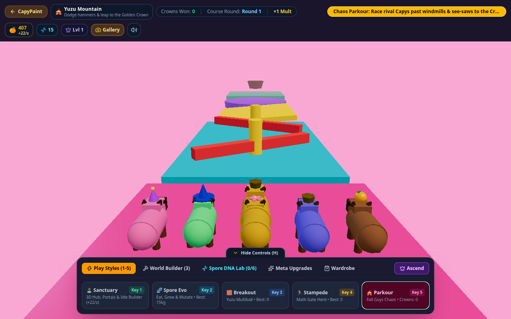
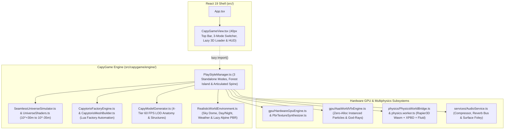

# CapyGame: Multi-Scale Universe Simulator, Forest Archipelago & Capytorio

[](https://capyboop.com/)
[](./LICENSE.md)

**CapyGame** is a hardware-accelerated 3D web game combining three cleanly separated standalone modes—**Infinite Zoom**, **Forest Games**, and **Capytorio**—built with React 19, TypeScript, Three.js (WebGL2), Vite 6, Tailwind CSS 4, and `@dimforge/rapier3d-compat` WebAssembly physics.

- **3 Standalone Modes & Clean Simulation Pausing**: Switch instantly via the compact `40px` top bar between **Infinite Zoom**, **Forest Games**, and **Capytorio**. Only the active game's 3D world, lighting, HUD, and simulation loop run at any time; inactive modes pause automatically and flush pending saves.
- **Infinite Zoom (`10^+30 m` to `10^-35 m` `1:1` Continuum)**: Pilot a time-traveling Chrono-Vessel continuously across 27 astrophysical and subatomic bands from the Multiverse through Big Bang inflation, spacetime manifold, observable horizon (`93.0 Gly`), cosmic web filaments, superclusters, clusters, selectable galaxy morphologies aiming onto **CapySol System** (`Orion-Cygnus Spur`) and **CapyWorld Planet**, emission nebulae & dust pillars, Keplerian stellar systems (`59.6 AU`), planetary clouds & surface biomes, a grounded **Forest Glade** and 11-specimen **Leaf & Fur Micro-Glade** (`10^-2 m`) with persistent **Discovery Sticker Book**, **Biological Cells**, a luminous **Chromatin & Nucleosome** transition into the **DNA Helix**, and down to `10^-35 m` (`0.62 l_P`) Planck Quantum Foam. Control flight via bottom-right **Rewind / Play-Pause / Fast Forward** buttons, a **Straight / Spiral** toggle (`360°` per band), `Telescope 1P` optics, unlockable **Object Finder Markers**, and a **Reality Rescaler**.
- **Forest Games (Unified Bridgeless Island)**: Roam one seamless, open-world tropical island combining four classic capybara mini-games—**Capy Sanctuary**, **Spore Lagoon**, **Number Stampede**, and **Yuzu Mountain Parkour**—with no bridges or forced transitions. Grow your articulated Dachshund Capy-Snake trail, place Sanctuary buildings, swim into bioluminescent waters to splice 3D DNA mutations, steer a capybara herd through arithmetic gates, and climb rigid-body parkour obstacles.
- **Capytorio (3D Factorio-Style Factory Automation)**: Build belt-fed automation across an endless lush meadow and citrus grove (`78` canonical Factorio recipes & `25` technologies parsed from `recipe.lua` and `technology.lua`, `44` placeable machines). Features brushed satin PBR metals, a steep **68° Overhead (`[V]`) / 3D Chase** camera, **Alt-Mode** item/machine/alert icons above buildings, compact arrow-only **Undo/Redo**, move-while-pasting **Blueprints**, a **10-Slot Recent-Items Quickbar (`[1]`–`[0]`)**, L-corner drag-paint belts, **Smart Pipette (`[Q]`)**, **Beacon Recall (`[H]`)**, and **Orbital Yuzu Rocket / UFO** launches.
- **First-Time Chrono-Genesis Setup & Procedural JSON Engine**: Customize your Capybara pilot, `ChronoVesselRig` finish, and the universe's Fine-Structure Constant ($\alpha^{-1} \in [60, 220]$, default CODATA `137.036`), or hot-reload deterministic `mulberry32` simulation seeds and presets (`capy_game_procedural_config_v1`).
- **Full-Profile Save Backup & Optional Cloud Sync**: Export, copy, drag-and-drop, or paste `capygame-save-bundle-v2` profiles (progression, Capytorio factory, settings, world seeds, and Yuzu Mountain ghost PB) in both Basic and Advanced Settings, with optional client-side Google Drive backup (`CapyGame-Cloud-Save.json`, `drive.file` minimal permission, in-memory OAuth tokens) and native Android Google Play Games Services v2 bridge support.
- **Fast Cold-Load, Lazy Chunk Splitting & Android TWA Readiness**: Instant static boot shell with post-paint lazy loading of Three.js, isolated `capy-shared-core`, `feature-universe`, and on-demand async chunks (`ForestDistrictBuilders`, `ForestMicroDioramaBuilder`, `CosmicUniverseBuilder`, Capytorio 3D runtime, and modals), idle Capytorio autosave scheduling, Android hardware Back modal dismissal and display-cutout safe-area insets, unified desktop/mobile WebGL2 `HalfFloatType` `EffectComposer` (HDR bloom, linearized Depth-SSAO, CAS sharpening, FXAA), Sobel tangent-space PBR textures, PMREM IBL, texel-snapped shadows, zero-allocation GPU `InstancedMesh` VFX, studio Web Audio synthesizer, and off-thread Rapier3D Wasm + XPBD soft-body physics.

---

## Visual Showcase

<p align="center">
  
  <br>
  <em>Capy Sanctuary Hub: Central 3D island with procedural exponential fruit trees, sunken Home Pool, Dachshund Capy-Snake trail, single 40px top control bar, and behind-the-capybara chase camera.</em>
</p>

<p align="center">
  
  <br>
  <em>Forest Games Unified Island: Seamless overland traversal across Sanctuary, Spore Lagoon, Number Stampede, and Yuzu Mountain with live multi-threaded Rapier3D Wasm physics.</em>
</p>

| **Spore Lagoon Evolution (`spore`)** | **Spore DNA Mutation Lab (`dna`)** |
| :---: | :---: |
|  |  |
| *Swim in the NW Lagoon, harvest plankton, and grow mass to earn Spore DNA* | *Equip visible 3D anatomical mutations including Flippers, Glide Wings, and Bioluminescent Tail* |

| **Capytorio Frontier (`capytorio`)** | **Number Stampede (`runner`)** |
| :---: | :---: |
|  |  |
| *Build 3D mining drills, chevron belts, inserters, foundries, assemblers & science labs across endless far-hemisphere ore plains* | *Steer your visible 3D capybara herd down the SW Causeway through arithmetic gates* |

<p align="center">
  
  <br>
  <em>Yuzu Mountain Parkour (`fallguys`): Navigate rigid-body sweeper hammers, torque-balanced see-saws, and XPBD soft-body launch pads in the SE Peak gauntlet.</em>
</p>

---

## Architecture Overview



---

## Three Standalone Modes & Playable Areas

| Mode / Area | Key | Core Mechanics | Progression & Unlocks |
| :--- | :--- | :--- | :--- |
| **Infinite Zoom** | `cosmos` | Continuous `10^+30 m` to `10^-35 m` Chrono-Vessel flight across 27 bands including Multiverse, galaxies, Forest Glade, Leaf/Fur Micro-Glade, Cells, Chromatin, DNA, and Planck Foam. | Micro-Glade Discovery Sticker Book, Object Finder Markers, Reality Rescaler, and Spore DNA. |
| **Forest Games: Sanctuary** | `sanctuary` | Central area of the unified bridgeless island; place and upgrade Onsen Hot Springs, Yuzu Orchards, Sacred Pagodas, and Bouncy Pads; bump matching trees to grow your Capy-Snake trail. | Sandbox island customization, CapyCoins, and Spore DNA milestones. |
| **Forest Games: Spore Lagoon** | `spore` | Walk straight into the NW sandy lagoon rim to swim through bioluminescent waters, harvest plankton, and splice 3D body mutations. | Spore DNA points and Lagoon mass high scores. |
| **Forest Games: Number Stampede** | `runner` | Guide your 3D Capybara herd along the SW island track through additive and multiplicative math gates. | Herd size records, DNA bonuses, and Stampede high scores. |
| **Forest Games: Yuzu Mountain** | `fallguys` | Climb the SE island gauntlet past rotating hammers, torque see-saws, and XPBD soft-body launch pads to claim the Golden Crown. | Crown completion DNA bonuses, ghost replays, and Yuzu Mountain high scores. |
| **Capytorio** | `capytorio` | Standalone endless lush meadow & citrus grove factory mode; harvest oranges/ore and automate `44` Factorio machines & belts (`78` Lua recipes, blueprint copy/paste, Alt-Mode icons). | `25` Factorio technologies, Spore DNA milestones, Orbital UFO/Rocket launches, and Factory scores. |

---

## Documentation Index

- **Technical Architecture & Engine Reference**: [`GAME.md`](./GAME.md)
- **Automated Testing & Verification Guide**: [`TESTING.md`](./TESTING.md)
- **Android Play Store & TWA Packaging Guide**: [`docs/ANDROID_PLAY_STORE.md`](./docs/ANDROID_PLAY_STORE.md)
- **Active Roadmap**: [`TODO.md`](./TODO.md)
- **Contributing Guide**: [`CONTRIBUTING.md`](./CONTRIBUTING.md)
- **Support & Help**: [`SUPPORT.md`](./SUPPORT.md)
- **Security Policy**: [`SECURITY.md`](./SECURITY.md)
<!-- capy-dev-only:start -->
- **Contributor & Operational Playbook**: [`AGENTS.md`](./AGENTS.md)
<!-- capy-dev-only:end -->

---

## Developer Quick Start

```bash
npm ci
npm run dev
```

Open `http://localhost:3000` in your browser.

### Build & Automated Verification

```bash
npm run lint                 # Strict TypeScript type-checking (tsc -p tsconfig.json --noEmit)
npm run test:unit            # Fast deterministic unit tests (8 suites: Progression, Save/Cloud Sync, Capytorio, Physics, Universe & GPU)
npm run build                # Production bundle compilation into dist/
npm run verify:playstore     # Play Store manifest, TWA version parity & cold-boot preload preflight
npm run test:game            # End-to-end Playwright suite (scripts/test-capygame.mjs)
npm run test:pwa             # Offline Service Worker & PWA manifest verification
npm run gallery:capture      # Capture 3D district showcase screenshots
npm run gallery:capture:zoom # Capture all 27 logarithmic universe scale screenshots
```
