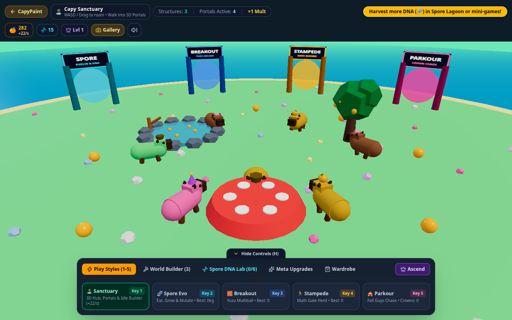
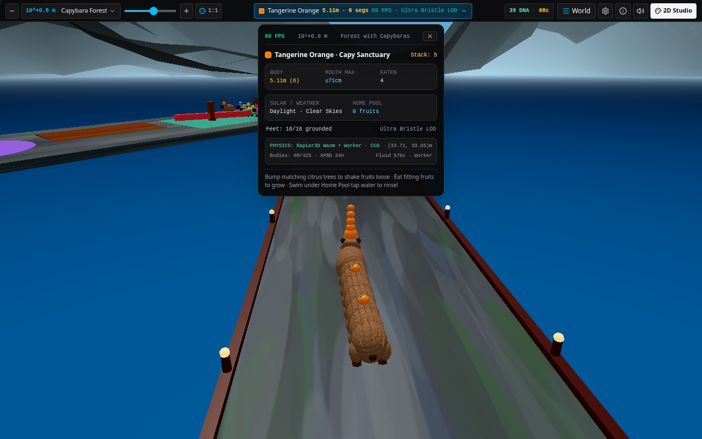
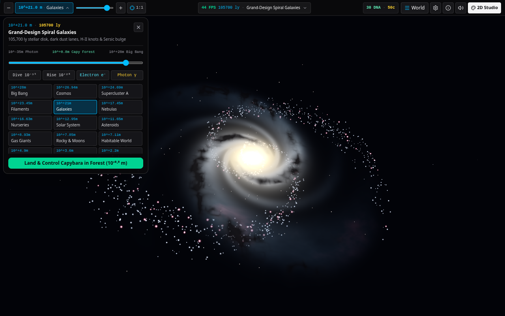
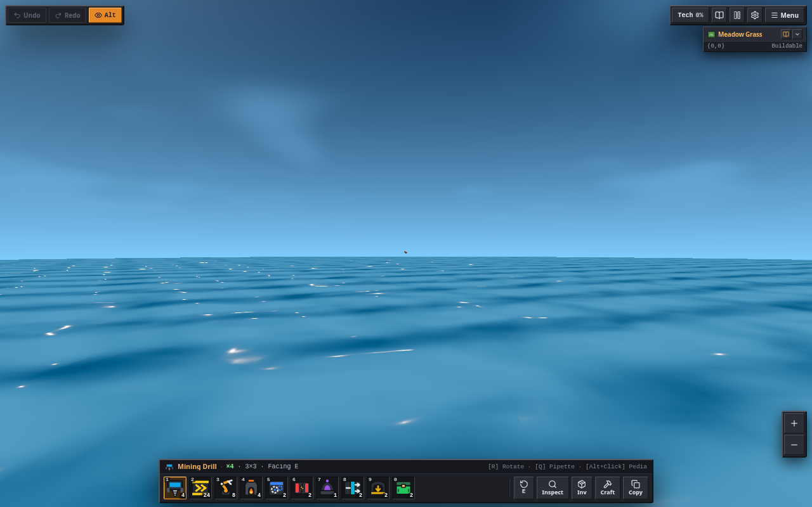
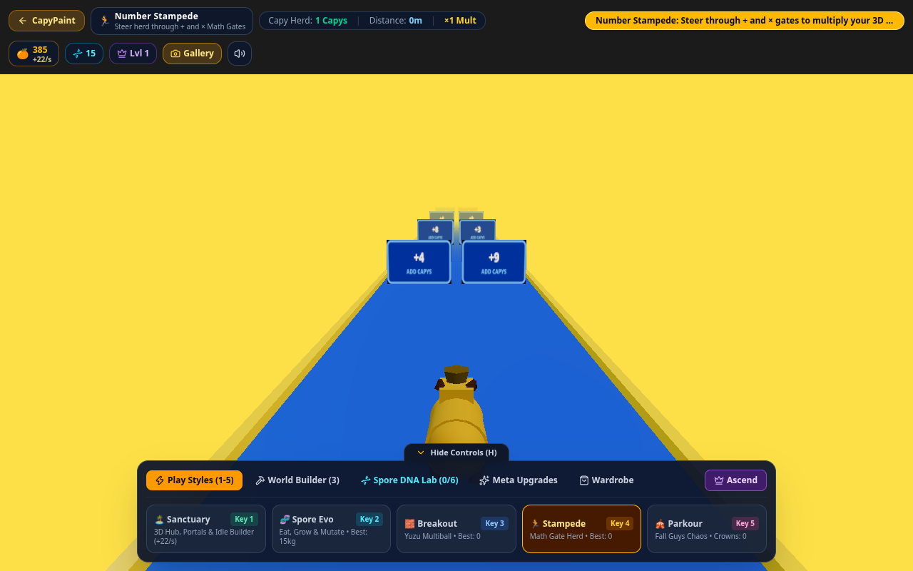
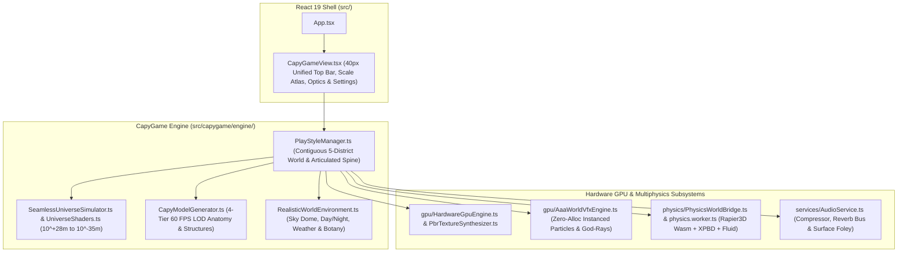

# CapyGame: Multi-Scale Universe Simulator & Contiguous Capybara World

[](https://shthed.github.io/capygame/)
[](./LICENSE.md)

**CapyGame** is a hardware-accelerated 3D multi-scale universe simulator, sandbox island builder, and multiphysics mini-game archipelago built with React 19, TypeScript, Three.js, Vite 6, Tailwind CSS 4, and `@dimforge/rapier3d-compat` WebAssembly physics.

- **65-Orders-of-Magnitude `1:1` Chrono-Vessel Continuum**: Pilot a time-traveling Future Capybara Chrono-Vessel continuously across 27 astrophysical bands from the `10^+30 m` Multiverse through Big Bang cosmic inflation, spacetime manifold, observable horizon (`93.0 Gly`), cosmic web filaments, superclusters, clusters, selectable galaxy morphologies (grand-design spiral, barred spiral, elliptical, irregular) aiming early onto **CapySol System** (`Orion-Cygnus Spur`) and **CapyWorld Planet**, emission nebulae & dust pillars, Keplerian stellar systems (`59.6 AU`), planetary touchdown onto the Sanctuary Chrono-Pad (`10^+0.8 m`), a randomized 11-specimen **Storybook Forest Micro-Glade** (`10^-2 m`: `Fur`, `Butterfly`, `Flower`, `Leaf`, `Wood`, `Mushroom`, `Amoeba`, `Bacterial`, `Virus`, `Clay`, `Rock`) with persistent **Discovery Sticker Book**, and down to `10^-35 m` (`0.62 l_P`) Planck Quantum Foam. Control flight via compact bottom-right **Rewind / Play-Pause / Fast Forward** buttons plus a **Straight / Spiral** toggle (curving `360°` around each zoom level), a top-right **Fullscreen** control, spoken scale cards, Basic Mode camera comfort guardrails, `Chase Pod 3P` / `Telescope 1P` optics, unlockable **Object Finder Markers**, and a **Logarithmic/Exponential Reality Rescaler**.
- **First-Time Chrono-Genesis Setup & Fine-Structure Constant ($\alpha$)**: On initial launch (and anytime via **Genesis Setup**), players customize their Capybara pilot archetype/fur/headgear, `ChronoVesselRig` Cherenkov/brass/canopy finish & scale, and the universe's Fine-Structure Constant ($\alpha^{-1} \in [60, 220]$, default CODATA `137.036`), dynamically scaling atomic Bohr orbitals, Dirac electron spinor velocity, QED photon wave-packets, and solar photosphere fusion tint in real time.
- **Built-In Live Procedural JSON Engine**: Customize and hot-reload universe gravity, star/galaxy density, planetary biomes, terrain elevation, weather, Chrono-Vessel colors, economy multipliers, and all 5 districts via deterministic `mulberry32` seeds and 5 one-click presets stored in `capy_game_procedural_config_v1` (`capy_game_onboarding_v1` tracks initial setup completion).
- **Contiguous Archipelago & Far-Hemisphere Capytorio**: Walk seamlessly overland between **Capy Sanctuary**, **Spore Lagoon**, **Number Stampede**, and **Yuzu Mountain Parkour**, or land on the untouched far hemisphere **Capytorio Frontier (`+1200, 0`)** to automate a full Factorio-inspired 3D factory directly driven by canonical `recipe.lua` and `technology.lua` definitions with infinite room to build, a **Top-Down Oblique (`[V]`) / 3D Chase** camera toggle, **Pocket Inventory Panel (`[I]`)**, **10-Slot Action & Machine Toolbar**, L-corner drag-paint belt laying, **Smart Pipette (`[Q]`)**, **Beacon Recall (`[H]`)**, direct generator/machine feeding (`[F]`), 6-step guided milestones, and Orbital Yuzu Rocket launches.
- **Hardware-Accelerated WebGPU & WebGL2 3D GPU + Multiphysics Engine**: Supports native `WebGPURenderer` with `128x128` WGSL compute shallow-water wakes, GPU indirect draw/occlusion culling compute, `16x9x24` Clustered Forward+ light binning, hardware `subgroups` detection, TSL atmospheric volumetric crepuscular sun shafts, Temporal Anti-Aliasing (`TRAANode`), and idle async shader warmup alongside WebGL2 `HalfFloatType` `EffectComposer` (HDR bloom + linearized Depth-SSAO + DoF + CAS), Sobel tangent-space PBR textures, PMREM IBL, texel-snapped solar shadow cascades, zero-allocation GPU `InstancedMesh` VFX, studio Web Audio synthesizer, and off-thread Rapier3D Wasm + XPBD soft-body physics.

---

## Visual Showcase

<p align="center">
  
  <br>
  <em>Capy Sanctuary Hub: Central 3D island with procedural exponential fruit trees, sunken Home Pool, Dachshund Capy-Snake trail, single 40px top control bar, and behind-the-capybara chase camera.</em>
</p>

<p align="center">
  
  <br>
  <em>Contiguous Single-World Archipelago: Seamless overland traversal across the paved Grand Promenade Causeways with live multi-threaded Rapier3D Wasm physics telemetry.</em>
</p>

| **Spore Lagoon Evolution (`spore`)** | **Spore DNA Mutation Lab (`dna`)** |
| :---: | :---: |
|  |  |
| *Swim in the NW Lagoon, harvest plankton, and grow mass to earn Spore DNA* | *Equip visible 3D anatomical mutations including Flippers, Glide Wings, and Bioluminescent Tail* |

| **Capytorio Frontier (`capytorio`)** | **Number Stampede (`runner`)** |
| :---: | :---: |
|  |  |
| *Build 3D mining drills, chevron belts, inserters, foundries, assemblers & science labs across endless far-hemisphere ore plains* | *Steer your visible 3D capybara herd down the SW Causeway through arithmetic gates* |

<p align="center">
  
  <br>
  <em>Yuzu Mountain Parkour (`fallguys`): Navigate rigid-body sweeper hammers, torque-balanced see-saws, and XPBD soft-body launch pads in the SE Peak gauntlet.</em>
</p>

---

## Architecture Overview



---

## Five Contiguous World Districts

| District Key | World Coordinates | Core Mechanics | Progression & Unlocks |
| :--- | :--- | :--- | :--- |
| `sanctuary` | **Capy Sanctuary (`0, 0`)** | Place and upgrade Onsen Hot Springs, Yuzu Orchards, Sacred Pagodas, and Bouncy Pads; bump matching trees to grow your Dachshund Capy-Snake trail. | Sandbox island customization, CapyCoins, and Spore DNA milestones. |
| `spore` | **Spore Lagoon (`-110, -110`)** | Walk down the NW Promenade beach into bioluminescent waters or swim across open sea channels to harvest plankton and splice 3D body mutations. | Spore DNA points and Lagoon mass high scores. |
| `capytorio` | **Capytorio Frontier (`+1200, 0`)** | Land on the untouched far hemisphere mineral plains with infinite build room to deploy Drills, Belts, Inserters, Furnaces, Assemblers, Coal Generators & Labs. | Space Age tech unlocks, DNA/Coins, Rocket launches, and Factory scores. |
| `runner` | **Number Stampede (`-110, +135`)** | Guide your 3D Capybara herd down the SW Causeway through additive and multiplicative math gates with side return boardwalks. | Herd size records, DNA bonuses, and Stampede high scores. |
| `fallguys` | **Yuzu Mountain (`+110, +135`)** | Climb the SE Gauntlet past rotating hammers, dynamic see-saws, and XPBD launch pads to claim the Golden Crown. | Crown completion DNA bonuses and Yuzu Mountain high scores. |

---

## Documentation Index

- **Technical Architecture & Engine Reference**: [`GAME.md`](./GAME.md)
- **Automated Testing & Verification Guide**: [`TESTING.md`](./TESTING.md)
- **Active Roadmap**: [`TODO.md`](./TODO.md)
- **Contributor & Operational Playbook**: [`AGENTS.md`](./AGENTS.md)

---

## Developer Quick Start

```bash
npm ci
npm run dev
```

Open `http://localhost:3000` in your browser.

### Build & Automated Verification

```bash
npm run lint                 # Strict TypeScript type-checking (tsc -p tsconfig.json --noEmit)
npm run test:unit            # Fast deterministic unit tests (ProgressionService, ColliderMath, UniverseScaleMath & GPU Culling/Cluster kernels)
npm run build                # Production bundle compilation into dist/
npm run test:game            # End-to-end Playwright suite (scripts/test-capygame.mjs)
npm run test:pwa             # Offline Service Worker & PWA manifest verification
npm run gallery:capture      # Capture 3D district showcase screenshots
npm run gallery:capture:zoom # Capture all 27 logarithmic universe scale screenshots
```
