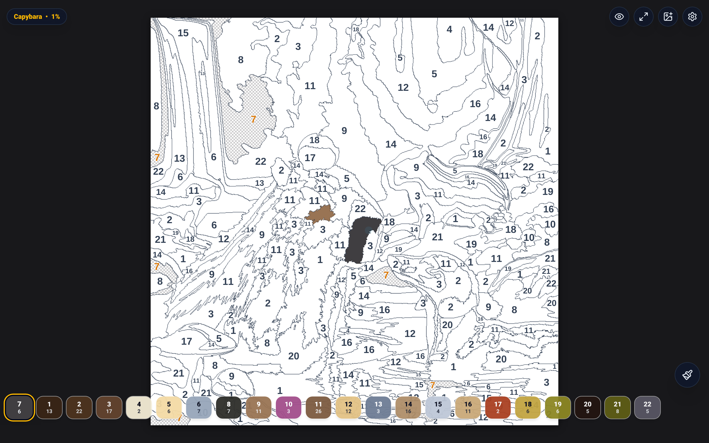
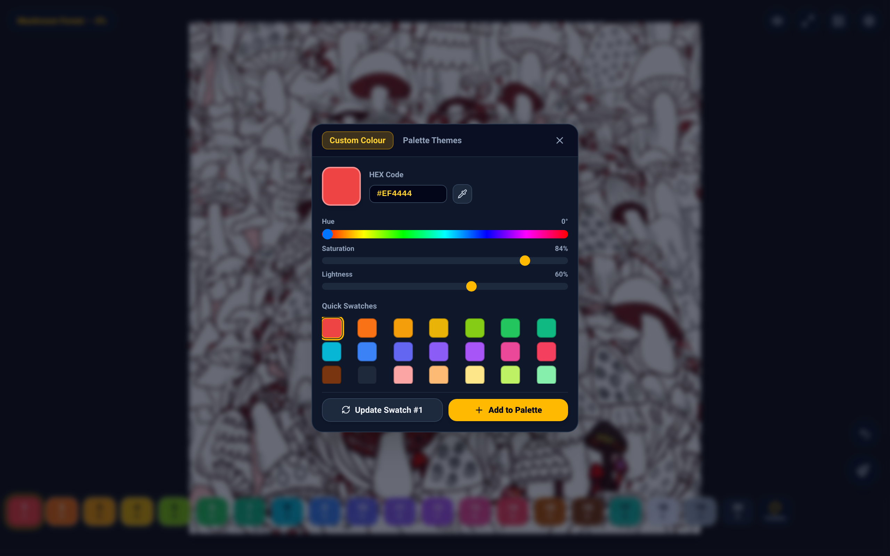
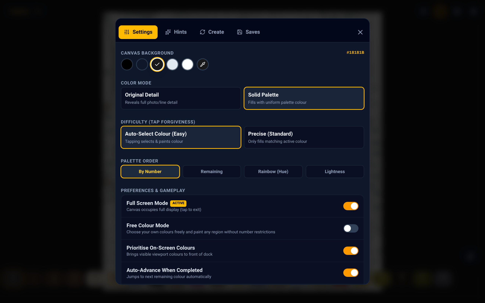
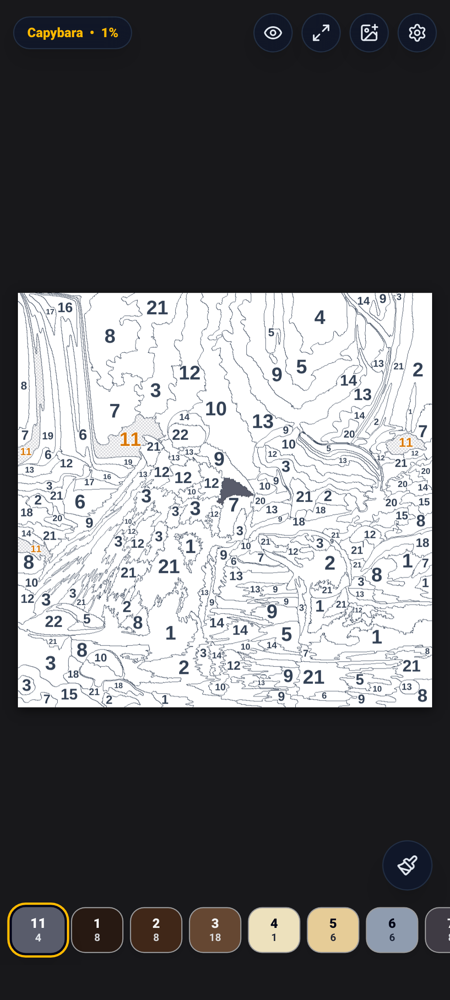
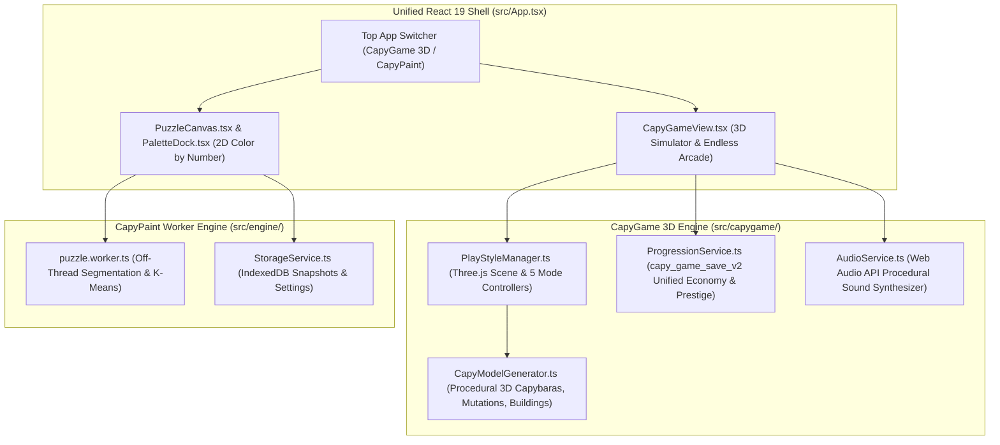

# Capy Suite: CapyGame 3D and CapyPaint

[](https://shthed.github.io/capygame/)
[](https://shthed.github.io/capygame/capy.apk)
[](./LICENSE.md)

**Capy** is a unified, multi-platform capybara web and Android suite combining two seamless experiences in a single application:

1. **CapyGame 3D**: A procedurally generated 3D capybara world-building simulator and endless multi-playstyle game featuring **Capy Sanctuary**, **Spore Lagoon Evolution**, **Yuzu Breakout**, **Number Stampede**, and **Yuzu Mountain Parkour**, unified by a single cross-mode economy, Spore DNA body mutations, and Prestige ascension.
2. **CapyPaint**: A high-precision vector color-by-number studio with a 5-strategy Web Worker segmentation pipeline, interior centroid labeling, Free Colour mode, and Google Maps-style pinch/pan canvas navigation.

- **[Play CapyGame 3D in Your Browser (`shthed/capygame`)](https://shthed.github.io/capygame/)**
- **[Download the Android APK (`shthed/capygame`)](https://shthed.github.io/capygame/capy.apk)**
- **[Play Original Capy Suite (`shthed/capy`)](https://shthed.github.io/capy/)**

---

## Visual Showcase: CapyGame 3D

<p align="center">
  
  <br>
  <em>Capy Sanctuary 3D Hub: Procedurally generated tropical island with 4 physical 3D World Portals, Cozy Onsens, Yuzu Orchards, Sacred Capy Pagodas, Bouncy Mushroom Pads, and unified HUD telemetry.</em>
</p>

| **Spore Lagoon Evolution (`spore`)** | **Spore DNA Mutation Lab (`dna`)** |
| :---: | :---: |
|  |  |
| *Eat plankton and smaller AI critters to grow mass and harvest evolutionary DNA* | *Equip 6 visible 3D body mutations: Aqua Flippers, Mighty Chomp Tusks, Armored Yuzu Shell, Celestial Glide Wings, Unicorn Prism Horn, and Bioluminescent Tail* |

| **Yuzu Breakout (`breakout`)** | **Number Stampede (`runner`)** |
| :---: | :---: |
|  |  |
| *Endless 3D arcade bumper arena with Multi-Yuzu and Wide-Capy powerup capsules* | *Steer your visible 3D capybara herd through additive and multiplicative math gates* |

<p align="center">
  
  <br>
  <em>Yuzu Mountain Parkour (`fallguys`): Dodge rotating wipeout hammers, cross tilting see-saw bridges, race AI rival capybaras, and leap to the Golden Crown finish line.</em>
</p>

---

## Visual Showcase: CapyPaint Color by Number

<p align="center">
  
  <br>
  <em>Interactive color-by-number canvas with responsive Palette Dock, dynamic active region highlighting, and centroid glow badges.</em>
</p>

| **Fine Zoom and Active Highlighting** | **Free Colour / Coloring Page Mode** |
| :---: | :---: |
|  |  |
| *Continuous zoom up to 12x with pole-of-inaccessibility labels and active region fills* | *Mushroom Forest with custom HSL/Hex palette picker and quick presets* |

| **Settings and Appearance Customizer** | **Mobile Portrait Experience** |
| :---: | :---: |
|  |  |
| *Circular background swatches, custom pipette color pickers, and smooth pan momentum* | *Full edge-to-edge touch UI with Google Maps-style one-finger drag zoom* |

---

## Unified Architecture Overview



---

## CapyGame 3D: Five Seamless Endless Play Styles

Players can switch instantaneously between all five 3D worlds using the bottom control dock, keyboard shortcuts (`1` through `5`), or by walking their Capybara directly into the four glowing **3D World Portals** on the Sanctuary island:

| Play Style Key | World Title | Core Endless Mechanics | Unified Rewards |
| :--- | :--- | :--- | :--- |
| `sanctuary` (`Key 1`) | **Capy Sanctuary** | Construct and upgrade 6 types of 3D structures (`Cozy Onsen`, `Yuzu Orchard`, `Bouncy Mushroom Pad`, `Emerald Bamboo Grove`, `Sacred Capy Pagoda`, `Golden Capy Monument`), bounce on giant mushrooms, and harvest Golden Yuzu. | Passive CapyCoins/sec (`CPS`) across all modes + `+15%` mini-game payout multiplier per `Sacred Capy Pagoda` level. |
| `spore` (`Key 2`) | **Spore Lagoon** | Swim across a primordial lagoon, eat glowing plankton and DNA helixes, and chomp smaller AI critters to dynamically grow your Capybara's 3D body scale (`sporeMass`). Press `Space` to lunge-dash. | High Spore DNA (`dna`) yield + CapyCoins and mass high scores (`highScoreSpore`). |
| `breakout` (`Key 3`) | **Yuzu Breakout** | Steer your Capybara bumper paddle to ricochet Golden Yuzu balls into procedurally generated 3D brick fortresses. Collect green **Multi-Yuzu** and blue **Wide-Capy** powerup capsules across endless waves. | Wave clear bonuses, combo multipliers, and `highScoreBreakout` records. |
| `runner` (`Key 4`) | **Number Stampede** | Guide your visible 3D herd of Capybaras down an endless highway through positive (`+3`, `x2`) and hazard (`-2`) math gates while smashing through wooden obstacle barrels. | Herd size coin multipliers, DNA bonuses, and `highScoreRunner` distance records. |
| `fallguys` (`Key 5`) | **Yuzu Mountain** | Race AI rival bean-capybaras up a multi-stage chaos obstacle course with spinning wipeout hammers, tilting see-saw bridges, and bouncy launch pads to claim the **Golden Crown**. | Escalating Crown jackpots (`200 * round` CapyCoins + `+4` DNA) and `highScoreFallGuys` crown tallies. |

---

## Controls and Shortcuts

### CapyGame 3D Controls

| Control / Input | Action |
| :--- | :--- |
| **WASD / Arrow Keys** | Move Capybara in 3D space (`Sanctuary`, `Spore Lagoon`, `Yuzu Mountain`) or steer left/right (`Breakout`, `Number Stampede`). |
| **Pointer Drag / Touch Joystick** | Direct horizontal tracking in `Breakout` and `Number Stampede`; virtual joystick steering in `Sanctuary`, `Spore Lagoon`, and `Yuzu Mountain`. |
| **Spacebar / JUMP Button** | Jump in `Sanctuary` and `Yuzu Mountain`; trigger a forward chomp dash in `Spore Lagoon`. |
| **Mouse Wheel** | Smoothly zoom the 3D camera in and out (`0.65x` to `1.75x`) across any play style. |
| **Keys `1` - `5`** | Instantaneously switch between `Sanctuary`, `Spore Lagoon`, `Yuzu Breakout`, `Number Stampede`, and `Yuzu Mountain`. |
| **Key `H`** | Collapse or expand the bottom control dock for an unobstructed full-screen 3D viewport. |

### CapyPaint Controls

| Gesture / Control | Action |
| :--- | :--- |
| **Tap Region** | Paints the region if it matches the selected active color. |
| **Drag Canvas** | Pans the artwork smoothly across the screen with inertial gliding momentum. |
| **Double-Tap and Drag Up / Down** | Google Maps-style one-finger zoom: drag up to zoom in, drag down to zoom out. |
| **Pinch / Mouse Wheel** | Multi-touch focal zoom in / zoom out up to 12x. |
| **Paint Brush Button** | Toggles continuous drag-to-paint mode. |
| **Undo (`Ctrl+Z`) / Long-Press Undo** | Undoes the last painted region or opens the interactive Replay timeline scrubber. |

---

## Developer Quick Start

```bash
npm install
npm run dev
```

Open [http://localhost:3000](http://localhost:3000) in your browser.

### Verification and Automated Browser Suites

```bash
npm run lint                                # TypeScript strict type-checking (tsc --noEmit)
npm run build                               # Production bundle compilation (dist/)
node scripts/test-capygame.mjs              # End-to-end Playwright suite for CapyGame 3D + CapyPaint switching
node scripts/capture-capygame-gallery.mjs   # Automated Playwright screenshot generator for docs/gallery/
```

---

## Technical Documentation and Architecture

- **Web Architecture and UI Reference**: [`WEB.md`](./WEB.md) -- Guide to React 19, Vite, Three.js `CapyGame 3D` architecture, 3-tier offscreen 2D canvas rendering, and storage schemas.
- **Android Native Launcher**: [`APP.md`](./APP.md) -- Kotlin launcher, AndroidX `WebViewAssetLoader`, native haptics bridge, and backup specifications.
- **Puzzle Generation Engine**: [`PUZZLE.md`](./PUZZLE.md) -- Web Worker segmentation, Sobel line extraction, Red-Mean K-Means clustering, and watershed absorption.
- **Testing Architecture**: [`TESTING.md`](./TESTING.md) -- Playwright E2E testing guide, 3D WebGL verification, and CI pipelines.
- **Project Roadmap and Tasks**: [`TODO.md`](./TODO.md) -- Active milestones and roadmap tracking.
- **Agent and Contributor Playbook**: [`AGENTS.md`](./AGENTS.md) -- Monorepo workflows, development rules, and PR standards.
